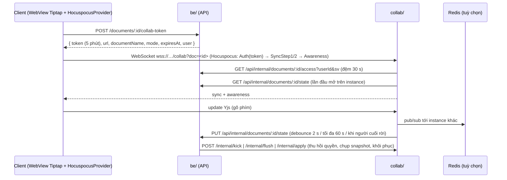

# collab — dịch vụ cộng tác thời gian thực

Package thứ tư của repo (cạnh `app/`, `admin/`, `be/`): một service Node.js **Hocuspocus + Yjs** phục vụ soạn thảo/vẽ đồng thời.
Dùng cho **Real-time Docs** (p6-01) và **Whiteboard** (p6-02) — cùng một service, phân biệt bằng *loại tài nguyên* (`document` → `doc:<id>`,
`whiteboard` → `wb:<id>`). Đặc tả: [`docs/plans/phase-6-collab-integrity-career/p6-01-real-time-docs/`](../docs/plans/phase-6-collab-integrity-career/p6-01-real-time-docs/be.md).

| | |
| --- | --- |
| Runtime | Node **20** (cùng image nền với `be/`), TypeScript strict, CommonJS |
| Thư viện chính | `@hocuspocus/server` **3.4.4** (chốt; 4.x đòi Node ≥ 22), `yjs`, `ws`, `express` 4, `jsonwebtoken`, `zod` 3, `prom-client`, tuỳ chọn `@hocuspocus/extension-redis` + `ioredis` |
| Cổng | **4000** (một cổng cho WebSocket + HTTP) |
| Dữ liệu | **Không** có DB riêng: BE là nguồn duy nhất (`Document.yjsState`); collab chỉ giữ Y.Doc trong RAM khi có người mở |
| Kiểm tra | `npm run check` = `tsc --noEmit` + `eslint` + `vitest run` |



## 1. Chạy

```bash
cd collab
cp .env.example .env        # điền COLLAB_SHARED_SECRET (≥ 32 ký tự, trùng be/.env) và BE_INTERNAL_URL
npm ci
npm run dev                 # tsx watch src/main.ts
npm run check               # typecheck + lint + test (cổng của CI job `collab`)
npm run build && npm start  # dist/main.js
```

Docker: `docker build -t super-app-collab collab/` (nền `node:20-alpine`, chạy user không phải root, `HEALTHCHECK` gọi `/health`).
`docker stop` gửi SIGTERM → **dừng êm**: ngừng nhận kết nối mới, lưu nốt mọi document còn state treo (debounce hoặc lần lưu trước lỗi),
đóng kết nối, chờ tối đa `SHUTDOWN_GRACE_MS` (25 s). Đặt `stop_grace_period` ≥ 30 s.

Test có Redis thật (nhiều instance) chỉ chạy khi có biến `REDIS_URL`: `REDIS_URL=redis://127.0.0.1:6379 npm test`
(dùng tiền tố khoá ngẫu nhiên, không đụng dữ liệu khác trong Redis).

### Cổng, health, tích hợp hạ tầng (cho `deploy/` — p0-11)

| Việc | Giá trị |
| --- | --- |
| Cổng nội bộ | `4000` (`PORT`) |
| Health | `GET /health` (không cần bí mật) → `200 { status: "ok" \| "degraded", version, instance, uptimeSeconds, kinds, connections, documents, pendingStates, redis: "ok" \| "error" \| "off", be: { lastOkAt, lastErrorAt } }`; **503** khi đang dừng. `degraded` = Redis lỗi hoặc BE lỗi liên tục trong 60 s gần nhất (vẫn 200 để không bị đá khỏi load balancer) |
| Metrics | `GET /metrics` (Prometheus; `Authorization: Bearer $METRICS_TOKEN` nếu đặt): `collab_connections{kind}`, `collab_documents_open{kind}`, `collab_store_total{kind,result}`, `collab_store_duration_seconds`, `collab_auth_total{result}`, `collab_kicks_total{reason}`, `collab_updates_total{kind}`, `collab_awareness_dropped_total{kind}`, `collab_be_request_duration_seconds{op,status}`, `collab_be_unavailable_total{op}`, `collab_pending_states`, `collab_pending_lost_total` + số đo tiến trình |
| Compose | service `collab`: `build: ../collab`, `environment` theo `.env.example`, `healthcheck` = `/health`, `stop_grace_period: 30s`, `depends_on: [redis]` (nếu dùng Redis) |
| BE đọc | `COLLAB_URL` (công khai, `wss://superapp.vcijsc.com/collab`), `COLLAB_INTERNAL_URL` (`http://collab:4000`), `COLLAB_SHARED_SECRET` (trùng với collab) |
| nginx | xem mẫu dưới. **KHÔNG** proxy `/internal/*`, `/metrics` ra Internet (collab cũng từ chối nâng cấp WebSocket ở các path đó) |

```nginx
upstream collab_upstream {
    hash $arg_doc consistent;          # một document → một instance (đỡ tải đồng bộ Redis)
    server collab:4000;
}
map $http_upgrade $connection_upgrade { default upgrade; '' close; }

location /collab/ {
    proxy_pass http://collab_upstream/;          # collab nâng cấp WebSocket ở MỌI path, bỏ hay giữ tiền tố /collab đều được
    proxy_http_version 1.1;
    proxy_set_header Upgrade $http_upgrade;
    proxy_set_header Connection $connection_upgrade;
    proxy_set_header Host $host;
    proxy_set_header X-Forwarded-For $proxy_add_x_forwarded_for;   # cùng TRUST_PROXY=true ở collab
    proxy_read_timeout 3600s;
    proxy_send_timeout 3600s;
}
```

Nhiều instance: đặt `REDIS_URL` cho **tất cả** instance (cùng `REDIS_KEY_PREFIX`). Lệnh doc-scoped của BE (`flush`/`apply`/`kick` theo `docId`) đi kèm
`?doc=<id>` nên load balancer băm theo `doc` sẽ đưa nó tới đúng instance đang giữ document; lệnh `kick` theo `userId`/`workspaceId` được instance nhận
phát tiếp cho các instance khác qua kênh pub/sub Redis `<REDIS_KEY_PREFIX>bus`. Mỗi instance lưu state độc lập nên BE sẽ **hợp nhất** (không ghi đè)
khi base version cũ — đúng nhưng tốn CPU hơn; giữ băm theo `doc`.

## 2. Biến môi trường

Danh sách đầy đủ + giải thích: [`.env.example`](.env.example). Bắt buộc: `BE_INTERNAL_URL`, `COLLAB_SHARED_SECRET` (≥ 32 ký tự; **khác** `JWT_SECRET`;
không có bí mật thì không khởi động). Chuỗi rỗng (`KEY=`) coi như chưa đặt. Lỗi cấu hình chỉ nêu **tên** khoá, không in giá trị.

## 3. Giao thức WebSocket (hợp đồng cho client — CHỐT)

Client dùng **`@hocuspocus/provider` 3.4.4** (cùng major với server; khoá đúng phiên bản trong `editor-web`). Y.Doc dùng Tiptap `Collaboration`
với **`field: "default"`** (một `Y.XmlFragment` tên `default` — BE dựng text tìm kiếm và khôi phục snapshot từ chính fragment này).

### 3.1 Kết nối

| Mục | Giá trị |
| --- | --- |
| URL | `${url}?doc=<resourceId>` — `url` = `COLLAB_URL` do BE trả trong `collab-token` (`wss://…/collab`). **Bắt buộc nhúng `?doc=` vào chuỗi `url`**: provider 3.4.4 không có option `parameters`. `doc` chỉ là gợi ý định tuyến cho nginx (băm sticky), server không dựa vào nó để phân quyền |
| `name` (documentName) | `doc:<id>` cho tài liệu, `wb:<id>` cho bảng trắng — lấy nguyên từ `collab-token.documentName`, **không tự ghép** |
| Token | JWT HS256 do BE cấp (`POST /documents/:id/collab-token`), sống 5 phút. **Không** đặt trong URL/log: truyền qua option `token` của provider (gửi trong tin `Auth` đầu tiên). `token` nên là **hàm** (`async () => currentToken`) vì provider gọi lại mỗi lần mở socket (kể cả nối lại) |
| Claim token | `iss=superapp-be` · `aud=collab` · `sub=<userId>` · `kind=document\|whiteboard` · `docId=<resourceId>` · `mode=edit\|view` · `sv=<sessionVersion>` · `jti` · `exp` (5 phút). Quyền thật do BE kiểm lại lúc kết nối: chế độ = **mức thấp hơn** của token và BE |
| Số kết nối | 1 socket / 1 document (không multiplex). Giới hạn: 50 kết nối/document, 10/người/document, 1000/IP |
| Trần dữ liệu | state document ≤ **5 MiB** (bảng trắng ≤ 9 MiB); một khung WebSocket client gửi lên ≤ 6 MiB (`WS_MAX_PAYLOAD_BYTES`; bảng > 6 MiB vẫn nạp được từ server nhưng một update > 6 MiB từ client bị đóng 1009); ≤ 200 message/giây/kết nối; bảng trắng thêm ≤ 60 tin awareness/giây/kết nối (`WB_AWARENESS_MAX_HZ`) |
| Đường dẫn | server nâng cấp WebSocket ở **mọi path** trừ `/internal*`, `/health`, `/metrics` |
| Timeout | socket không xác thực trong 10 s bị đóng (4408); ping/pong 30 s; provider tự đóng nếu 30 s không nhận gì (awareness 15 s/lần giữ sống) |

### 3.2 Chế độ ghi/đọc

`authenticated` phát ra scope **`read-write`** hoặc **`readonly`** (`provider.authorizedScope`). Kết nối `readonly` **nhận** update của người khác nhưng update nó gửi bị server
từ chối (không áp, không lưu) — UI phải ẩn công cụ sửa. Tài liệu `ARCHIVED` luôn `readonly`. Khi quyền đổi từ sửa → xem lúc đang mở (vòng kiểm lại ≤ 30 s hoặc BE gọi kick),
server chuyển kết nối sang chỉ đọc và gửi thông báo `READ_ONLY` (§3.5).

### 3.3 Awareness (con trỏ/hiện diện)

Trạng thái awareness của client chỉ được có các khoá sau (khoá lạ → đóng kết nối `awareness-invalid`):

| Loại | Khoá cho phép |
| --- | --- |
| `document` | `user`, `cursor` (do `y-prosemirror` cursor plugin đặt) |
| `whiteboard` | `user`, `pointer`, `selection`, `viewport` |

`user = { id: string, name: string (≤ 80 ký tự), color: "#RRGGBB" }`. **`user.id` phải bằng `sub` của token** (server so với danh tính đã xác thực; state của chính kết nối
mà mang id khác bị coi là giả danh). `name`/`color` lấy từ `collab-token.user` (BE tính, màu chọn từ bảng 8 màu tương phản). Mỗi state ≤ 2 KiB. Gửi `null` khi rời (provider tự làm).
Lưu ý: provider 3.4.4 phản hồi lại cả state của người khác — server chỉ kiểm cấu trúc với state không thuộc về kết nối gửi.

**Tần suất (bảng trắng).** Client throttle awareness ≤ 30 lần/giây. Server có token-bucket riêng `WB_AWARENESS_MAX_HZ` (mặc định 60/giây/kết nối): vượt thì **bỏ tin** (không đóng kết nối; đếm ở `collab_awareness_dropped_total{kind="whiteboard"}`) vì awareness là trạng thái tạm. Chỉ tin mang state sống của CHÍNH kết nối gửi được tính; tin phản hồi state người khác và tin rời (`null`) không tính. Tin sai định dạng/giả danh vẫn đóng kết nối. `document` không có trần riêng.

**Client bảng trắng KHÔNG được phản hồi lại state người khác.** `HocuspocusProvider` 3.4.4 mặc định gửi lại mọi thay đổi awareness (kể cả state vừa nhận) ⇒ mỗi kết nối bị đổ ≈ (N−1)×tần suất tin vào trần chung 200/s (đo: 30 client ~22 Hz bị đóng `rate-limited` sau ~0,4 s). Bắt buộc lọc:
`provider.awareness.off("update", provider.boundAwarenessUpdateHandler); provider.awareness.on("update", (c, origin) => { if (origin !== provider) provider.awarenessUpdateHandler(c, origin); });`
(`editor-web` của tài liệu cũng chưa lọc — chưa gây lỗi ở quy mô 50 client/tài liệu nhưng nên lọc khi đụng tới.)

### 3.4 Từ chối và đóng kết nối

Khi từ chối xác thực, server gửi `authenticationFailed { reason }` (provider: `onAuthenticationFailed`) rồi **đóng socket** với mã tương ứng. Khi đang chạy, thu hồi/lưu trữ = tin CLOSE trong luồng
(provider: `onClose({ event })` với `event.reason`) rồi đóng socket. **Provider tự nối lại mỗi ~1 s sau mọi lần đóng** — client phải chủ động dừng khi cần.

| `reason` | Mã đóng | Ý nghĩa | Client làm |
| --- | --- | --- | --- |
| `unauthorized` | 4401 | token thiếu/sai chữ ký/hết hạn/không khớp document | xin token mới (`POST …/collab-token`) rồi để provider nối lại; tối đa 1–2 lần liên tiếp rồi báo lỗi |
| `forbidden` | 4403 | không (còn) quyền | **dừng nối lại** (`websocketProvider.disconnect()`), thông báo trung tính, thoát màn hình |
| `not-found` | 4404 | tài nguyên không tồn tại / loại không phục vụ | dừng |
| `too-many-connections` | 4429 | vượt giới hạn kết nối | thử lại sau vài giây (có backoff) |
| `unavailable` | 4503 | collab không hỏi được BE (fail-closed) | thử lại có backoff; hiện "Mất kết nối" |
| `revoked` | 4403 | quyền vừa bị thu hồi/đổi — **nối lại để xác thực lại** | để provider tự nối lại; nếu hết quyền sẽ nhận `forbidden` |
| `archived` | 4409 | tài liệu vừa được lưu trữ | nối lại (sẽ vào chế độ `readonly`), hiện banner "Đã lưu trữ" |
| `rate-limited` | 4429 | gửi quá nhanh | giảm tần suất; không nối lại dồn dập |
| `unsupported-message` / `awareness-invalid` | 4400 | client gửi thứ không cho phép (Stateless, awareness sai…) | lỗi client — dừng, báo lỗi |
| `auth-timeout` | 4408 | không xác thực kịp | nối lại |
| (mã 1009) | 1009 | khung > 6 MiB | tài liệu quá lớn |

Client **không** được gửi tin `Stateless`/`BroadcastStateless` (bị chặn, kể cả viewer) — dùng REST cho mọi thứ ngoài Yjs/awareness.

### 3.5 Thông báo từ server (`provider.on("stateless")`)

JSON `{ "v": 1, "type": "notice", "code": … }`:

| `code` | Khi nào | UI |
| --- | --- | --- |
| `SAVE_FAILED` | lưu về BE lỗi tạm thời (collab giữ state, thử lại) | chấm "Chưa lưu được — sẽ thử lại"; **vẫn gõ được**, các client vẫn đồng bộ với nhau |
| `SAVE_RECOVERED` | lưu lại thành công sau `SAVE_FAILED` | "Đã lưu" |
| `TOO_LARGE` | state vượt 5 MiB, BE không nhận | "Tài liệu quá lớn" — ngừng chèn thêm |
| `ARCHIVED` | BE từ chối ghi vì tài liệu đã lưu trữ | banner "Đã lưu trữ" (sắp bị đóng để nối lại chế độ xem) |
| `RESTORED` | nội dung vừa bị thay bằng bản khôi phục snapshot | toast "Tài liệu vừa được khôi phục về một phiên bản cũ" |
| `READ_ONLY` | quyền của bạn vừa bị hạ xuống chỉ xem | ẩn toolbar sửa |

### 3.6 Mất mạng / nối lại (CW-06, CW-D5)

- Mất mạng: Y.Doc trong WebView giữ mọi thay đổi (`provider.hasUnsyncedChanges === true` → hiện "Đang ngoại tuyến"). Nối lại: provider tự chạy lại SyncStep1/2 → hợp nhất hai chiều, không mất ký tự.
- Token chỉ kiểm lúc **thiết lập kết nối** (không kiểm lại trong phiên). Token hết hạn khi mất mạng lâu → lần nối lại nhận `unauthorized` → xin token mới. Native làm mới token trước hạn 60 s (`expiresAt − 60 s`) và gửi `setToken`; hàm `token` của provider luôn trả token mới nhất.
- Thu hồi quyền có hiệu lực **≤ 30 s** kể cả khi tin kick của BE thất lạc (`ACCESS_RECHECK_MS`); thường là tức thì nhờ `/internal/kick`.

### 3.7 Mẫu client (editor-web)

Bản thật: [`editor-web/src/session.ts`](editor-web/src/session.ts) (adapter provider) + [`connection.ts`](editor-web/src/connection.ts) (nối lại/xin token/dừng theo bảng §3.4) + [`close-policy.ts`](editor-web/src/close-policy.ts) (bảng §3.4 dạng hàm thuần, có test). Rút gọn:

```ts
const socket = new HocuspocusProviderWebsocket({ url: `${collabUrl}?doc=${docId}`, autoConnect: false });
const provider = new HocuspocusProvider({
  websocketProvider: socket,
  name: documentName,                       // "doc:<id>" từ collab-token
  document: ydoc,
  token: async () => latestToken(),         // gọi lại mỗi lần mở socket; token hết hạn thì chờ app `setToken` (≤ 6 s, < 10 s auth-timeout của server)
  onAuthenticationFailed: ({ reason }) => { /* theo bảng §3.4: unauthorized → socket.disconnect() + bridge `requestToken`; forbidden/not-found → disconnect + `error` nghiêm trọng */ },
  onClose: ({ event }) => { /* cùng bảng; tin CLOSE trong luồng (code 1000 + reason) LẪN đóng socket thô đều tới ⇒ xử lý idempotent */ },
  onStateless: ({ payload }) => handleNotice(JSON.parse(payload)),
});
provider.attach();                          // bắt buộc khi truyền websocketProvider riêng
provider.setAwarenessField("user", { id: me.id, name: me.name, color: me.color });
socket.connect();
// Tiptap 3: Collaboration.configure({ document: ydoc, field: "default" }) + CollaborationCaret.configure({ provider, user: { id, name, color } })
```

## 4. Hợp đồng nội bộ

Mọi lời gọi hai chiều mang header **`X-Collab-Secret: <COLLAB_SHARED_SECRET>`** (so sánh thời gian hằng). Dùng phong bì chuẩn của BE `{ success, data }` / `{ success: false, error: { code, message } }`.

### 4.1 collab → BE (`<BE_INTERNAL_URL>/api/internal/<documents|whiteboards>/:id/…`, timeout 5 s, thử lại 2 lần với lỗi mạng/5xx/429)

| Lời gọi | Kết quả |
| --- | --- |
| `GET …/access?userId=<oid>&sv=<int>` | `200 data: { allowed: true, mode: "edit"\|"view", user: { id, name, color }, workspaceId, limits?: { maxConnections } }` hoặc `{ allowed: false, reason? }`; `404` không tồn tại |
| `GET …/state` | `200 application/octet-stream` (Yjs update đầy đủ, **rỗng** nếu chưa có) + `X-Yjs-Version`; `404` |
| `PUT …/state` (body octet-stream ≤ 6 MiB; `X-Yjs-Version` = version collab đang giữ; `X-Last-Editor` = userId) | `200 data: { yjsVersion, merged }`; `413 DOC_006` quá lớn; `409 DOC_008` đã lưu trữ; `404` |

`PUT` với `X-Yjs-Version` **nhỏ hơn** version hiện tại của BE (có ai ghi xen giữa: khôi phục snapshot, instance khác) → BE **hợp nhất** Yjs thay vì ghi đè; `yjsVersion = max(hiện tại, base) + 1`.

### 4.2 BE → collab (`<COLLAB_INTERNAL_URL>`, kèm `?doc=<id>` cho lệnh theo tài liệu)

| Lời gọi | Body | Kết quả |
| --- | --- | --- |
| `POST /internal/kick` | `{ kind?: "document"\|"whiteboard", docId?, userId?, workspaceId?, reason: "revoked"\|"archived"\|"forbidden" }` — ít nhất một bộ lọc (AND) | `data: { closed }` (số kết nối đóng ở instance này; phát tiếp cho instance khác qua Redis) |
| `POST /internal/flush` | `{ kind?, docId }` | ép lưu NGAY state đang sống về BE → `data: { open, flushed, yjsVersion }` (BE gọi trước khi chụp snapshot/khôi phục) |
| `POST /internal/apply` | `{ kind?, docId, updateBase64, reason? }` (≤ 16 MiB) | áp một Yjs update (delta khôi phục do BE tính) lên document đang mở → phát cho mọi client + thông báo `RESTORED` → `data: { open, applied, connections }`; không mở → `open: false` |
| `GET /internal/stats` | — | `data: { connections, documents, pendingStates }` theo loại |
| `GET /health`, `GET /metrics` | — | xem trên |

`kind` mặc định `document`: BE PHẢI truyền `kind: "whiteboard"` khi kick/flush/apply bảng trắng (thiếu ⇒ `closed: 0`).

Mã lỗi: `401 AUTH_002` sai/thiếu bí mật · `400 VAL_001` sai đầu vào · `413` body quá lớn.

## 5. Độ tin cậy

- **BE là nguồn duy nhất.** `onLoadDocument` luôn đọc BE; không cache đĩa. Hai instance/phiên nào cùng giữ document đều hợp nhất được nhờ CRDT.
- **Lưu không bao giờ ném lỗi ra ngoài.** BE chậm (≤ 3 s trong test) → update gõ trong lúc chờ không mất (Hocuspocus tuần tự hoá lần lưu và lần sau mang state mới nhất). BE lỗi → state được **giữ trong RAM**, thử lại backoff (2 s → 60 s), document **không bị dỡ** khỏi RAM tới khi lưu được, client nhận `SAVE_FAILED`. Quá `PENDING_MAX_DOCS` (500) → bỏ cái cũ nhất, log lỗi + `collab_pending_lost_total`.
- **Fail-closed với kết nối mới** khi BE không kiểm quyền được (`unavailable`); **fail-open với kết nối đang mở** khi vòng kiểm lại gặp BE lỗi (không đá hàng loạt lúc BE chớp tắt).
- **Dừng êm** lưu nốt state; SIGKILL/crash chỉ mất tối đa `STORE_DEBOUNCE_MS`–`STORE_MAX_DEBOUNCE_MS` (2–60 s) thay đổi chưa lưu — client còn giữ bản trong RAM và tự đẩy lên lại khi nối lại.
- Chống lạm dụng: giới hạn kết nối/IP/document/người, IP thất bại xác thực > 30/phút bị 429 ở bước nâng cấp, timeout xác thực, token-bucket message, chặn Stateless, kiểm awareness, `maxPayload` 6 MiB.

## 6. Bảo mật

- Token chỉ HS256 (`none`/RS* bị từ chối), `aud`/`iss`/`exp` bắt buộc; bí mật **riêng** cho collab (không dùng `JWT_SECRET`).
- Không log token/bí mật/nội dung tài liệu (chỉ id, mã lỗi, kích thước).
- `/internal/*` chỉ mở trong mạng nội bộ (compose network); không proxy ra Internet. Bí mật so sánh bằng `timingSafeEqual`.
- Admin **không** có đường đọc nội dung tài liệu qua collab.

## 7. Kiểm thử (vitest, WebSocket + HocuspocusProvider thật, BE giả bằng HTTP thật)

| Tệp | Kịch bản |
| --- | --- |
| `tests/sync.test.ts` | **CW-05** hai/ba người gõ đồng thời hội tụ, không mất ký tự; awareness có tên/màu; người vào sau nhận đủ nội dung |
| `tests/offline.test.ts` | **CW-06** mất mạng rồi gõ tiếp → hợp nhất; token gọi lại khi nối lại (nền CW-D5); collab dừng/chạy lại |
| `tests/readonly.test.ts` | **CW-D3** viewer gửi update/SyncStep2 bị từ chối |
| `tests/revoke.test.ts` | **CW-D1** kick theo doc/user/workspace, lưu trữ, vòng kiểm lại ≤ chu kỳ, hạ quyền sửa→xem, BE chớp tắt |
| `tests/persistence.test.ts` | debounce, lưu khi rời, BE chậm 3 s không mất update, BE lỗi/sập → giữ + thử lại, quá lớn, lưu trữ, **CW-D4** khôi phục snapshot (apply + hợp nhất), flush, dừng êm |
| `tests/auth.test.ts` | token (chữ ký/hết hạn/aud/iss/alg/claim), từ chối theo lý do + mã đóng, giới hạn, chặn IP, timeout xác thực |
| `tests/guard.test.ts` | chặn Stateless/Broadcast, awareness giả danh/sai khoá/quá lớn, flood |
| `tests/whiteboard.test.ts` | **CW-07** viewer bị từ chối update/SyncStep2; **CW-08** trần awareness (bỏ tin không đóng; echo/tin rời không tính; giả danh vẫn đóng; 30 client × 30 Hz); **WB-01** đổi màu + di chuyển cùng hình, cùng trường hội tụ; định tuyến `wb:` (đường BE, khoá awareness, token kind), trần 9 MiB so với 5 MiB, kick/flush/apply theo kind |
| `tests/internal-api.test.ts`, `tests/config.test.ts` | bí mật nội bộ, validation, /health, /metrics, cấu hình |
| `tests/redis.test.ts` | (cần `REDIS_URL`) hai instance đồng bộ + kick qua bus |
| `editor-web/tests/` | (package riêng, `cd editor-web && npm run check`) bridge/token hết hạn/chế độ xem/dữ liệu cắt-đầy, lệnh toolbar → node, hội tụ hai editor; `tests/e2e/` chạy **editor thật ↔ server collab này** (CW-05/06/D3/D5, forbidden, archived, SAVE_FAILED) và bundle `dist/editor.html` trong Chrome headless (xem §10) |

Chưa tự động: **CW-D6** (50 client/document, p95 ≤ 300 ms — k6/script ws, chạy ở staging) và các ca thiết bị (Android/iOS, Telex/VNI trên WebView + bàn phím thật) của app — bundle mới chỉ được thử với IME mô phỏng trên Chrome headless.

## 8. Dùng lại cho Whiteboard (p6-02)

Đã sẵn: registry loại tài nguyên (`src/resource-kinds.ts`: prefix `wb:`, đường BE `whiteboards`, trần 9 MiB, khoá awareness riêng), claim `kind` trong token,
`COLLAB_KINDS=document,whiteboard` để bật. p6-02 còn cần (BE): module `whiteboards` cài `GET|PUT /api/internal/whiteboards/:id/(access|state)` cùng hợp đồng §4.1; (collab) thêm
kiểm số phần tử nếu muốn báo sớm (BE làm, `WB_007`). Giới hạn tần suất awareness (`WB_AWARENESS_MAX_HZ`) đã có ở `src/extensions/awareness-rate-limit.ts` (§3.3).

## 9. Thư mục

```
collab/
  src/           main.ts · server.ts · config.ts · be-client.ts · access-service.ts · connections.ts · errors.ts · metrics.ts · logger.ts
    auth/        verify-collab-token.ts
    extensions/  authentication.ts · persistence.ts · message-guard.ts · awareness-rate-limit.ts · access-recheck.ts · redis.ts
    internal/    router.ts (/health /metrics /internal/*) · ops.ts (kick/flush/apply/stats)
  tests/         vitest (helpers/be-mock.ts, helpers/harness.ts, fixtures/)
  editor-web/    (KHÔNG thuộc server — package riêng, do phần app sở hữu: Vite + Tiptap 3 + y-tiptap; có package.json/lockfile riêng,
                  loại khỏi tsconfig/eslint/Docker của server; xem §10)
```

## 10. editor-web — bundle soạn thảo Tiptap + Yjs trong WebView (p6-01)

`editor-web/` là **client** của giao thức §3, build ra MỘT file HTML mà app nạp vào WebView. Package riêng (`package.json`/lockfile riêng: `cd editor-web && npm ci`),
KHÔNG thêm dependency editor vào `package.json` của server. Nguồn sự thật của bridge: [`editor-web/src/bridge-protocol.ts`](editor-web/src/bridge-protocol.ts) (kiểu, app sao chép/đối chiếu)
+ [`bridge-validate.ts`](editor-web/src/bridge-validate.ts) (kiểm tra lúc chạy, có cả `parseEditorMessage` cho phía app).

| | |
| --- | --- |
| Thư viện (chốt đúng phiên bản) | Tiptap **3.31.3** (StarterKit: đậm/nghiêng/gạch/gạch chân/code, heading 1–3, danh sách, trích dẫn, code block, đường kẻ, link; + checklist, bảng cơ bản, node ảnh riêng), `@tiptap/y-tiptap` 3.0.9 (fork y-prosemirror mà Tiptap 3 dùng — cùng cấu trúc `Y.XmlFragment`), `@hocuspocus/provider` **3.4.4**, `yjs` 13 |
| Kiểm tra | `cd editor-web && npm run check` = `tsc` + `eslint` + `vitest` (jsdom; gồm e2e với server collab thật + Chrome headless nếu có `collab/node_modules`/`dist/editor.html`/Chrome). `npm run check:all` thêm build + `typecheck:e2e` |
| Build | `npm run build` → `dist/editor.html`: một file, script nội tuyến, **CSP ghim hash sha256**, không request mạng ngoài (script `finalize-bundle` kiểm và làm hỏng build nếu vi phạm hoặc > 1,5 MB). Thực tế ≈ 0,6 MB (gzip ≈ 0,19 MB) |
| Chép sang app | `npm run copy:app` → `app/assets/collab/editor.html` (`--dry-run`, `--dest <đường-dẫn>`). App khai `html` trong `assetExts` của Metro |

### 10.1 Bridge RN ↔ WebView (JSON `{ v: 1, type, payload }`, `injectJavaScript`/`postMessage` cho app→web, `ReactNativeWebView.postMessage` cho web→app)

| app → web | Ý nghĩa |
| --- | --- |
| `init` | `{ url, token, expiresAt?, documentName, mode: edit\|view\|comment, user: {id,name,color}, locale?, theme?, placeholder?, stateMaxBytes? }` lấy nguyên từ `POST /documents/:id/collab-token` (+ `GET /documents/:id`). Editor nối `?doc=<id>` vào `url`, đối chiếu `user.id` = `sub` và `docId` trong token (sai ⇒ từ chối init). `{ source: "snapshot", yjsState }` = xem bản lịch sử chỉ đọc (base64 từ `GET …/snapshots/:sid`), không kết nối |
| `setToken` | `{ token, expiresAt? }` — làm mới trước hạn 60 s hoặc đáp `requestToken` |
| `command` | `{ name, attrs?, requestId? }`: `bold italic underline strike code paragraph heading{level 1–3} bulletList orderedList taskList blockquote codeBlock horizontalRule indent outdent undo redo clearFormatting link{href\|null} insertTable{rows,cols} tableAddRow/AddColumn/DeleteRow/DeleteColumn/Delete focus{position} blur` |
| `insertImage`, `assetUrl` | `{ assetId, alt? }` (đã upload scope `DOC` + `POST /documents/:id/assets`) · đáp `resolveAssetUrl`: `{ assetId, url, expiresAt? }` hoặc `{ assetId, error }` |
| `setMode`, `setTheme`, `retry`, `dispose` | đổi chế độ hiển thị (không vượt quyền server) · giao diện · nối lại thủ công · dọn phiên trước khi huỷ WebView |

| web → app | Ý nghĩa |
| --- | --- |
| `ready` | bundle sẵn sàng nhận `init` (kèm `protocol`, `bundle`, danh sách lệnh) |
| `status` | `{ connection: connecting\|synced\|offline\|closed, unsynced, saveFailed, mode, readOnly, archived, tooLarge, nearLimit }` — app ẩn toolbar khi `readOnly`, hiện banner theo cờ |
| `selectionState`, `awareness` | định dạng tại con trỏ (tô sáng toolbar) · người đang mở `{ users[], count }` (một người nhiều máy = một) |
| `requestToken` | `{ reason: expired\|unauthorized, attempt }` — app gọi lại `collab-token` rồi `setToken` |
| `resolveAssetUrl`, `requestImage`, `openLink` | xin URL ký cho ảnh · người dùng dán/thả ảnh · chạm liên kết khi chỉ đọc (app xác nhận rồi mở) |
| `notice`, `commandResult`, `error` | thông báo server (§3.5) · kết quả lệnh có `requestId` (`read-only`, `loading`, `too-large`…) · `{ code: AUTH_EXPIRED\|FORBIDDEN\|NOT_FOUND\|TOO_LARGE\|LOAD_FAILED\|INVALID_MESSAGE, fatal }` |

Hành vi kết nối (theo bảng §3.4, đã kiểm với server thật): `unauthorized` ⇒ dừng nối ngay + `requestToken` (quá 2 lần liên tiếp ⇒ `error AUTH_EXPIRED`); `forbidden`/`not-found`/`unsupported-message`/`awareness-invalid`/khung > 6 MiB ⇒ `disconnect()` + `error` nghiêm trọng, KHÔNG nối lại;
`unavailable`/`too-many-connections`/`rate-limited` ⇒ backoff 2 s→30 s; `revoked`/`archived`/`auth-timeout` ⇒ để provider nối lại (archived ⇒ chỉ đọc). Token hết hạn lúc mất mạng: hàm `token` của provider chờ `setToken` (≤ 6 s) trước khi mở socket.

### 10.2 Ràng buộc schema (quan trọng)

- Nội dung ở `Y.XmlFragment` `default`; tên node đúng bảng BE nhận biết (`paragraph heading bulletList orderedList listItem taskList taskItem blockquote codeBlock horizontalRule hardBreak table tableRow tableHeader tableCell`; `image` chỉ có `assetId`/`alt`, **không có URL**). Test `editor-collab.test.ts` khoá tập node/mark.
- ⚠ y-tiptap tự **xoá khỏi Y.Doc dùng chung** mọi node mà schema máy đó không dựng được. Bản app CŨ mở tài liệu có node mới sẽ xoá node đó cho mọi người ⇒ thêm/đổi node hoặc mark phải đi kèm chặn phiên bản app cũ (cờ `collab` + phiên bản tối thiểu) — không tự ý đổi schema.
- Đổi kiểu khối (đoạn văn → tiêu đề) trong lúc người khác gõ vào đúng khối đó làm mất phần người kia gõ (đặc tính của y-prosemirror: kiểu khối là tên `XmlElement`); gõ đồng thời bình thường thì hội tụ đầy đủ.
- Không có: tệp đính kèm không phải ảnh (BE chỉ nhận ảnh scope `DOC`), mention/bình luận lề (P1), lưu offline dài ngày (P2).
